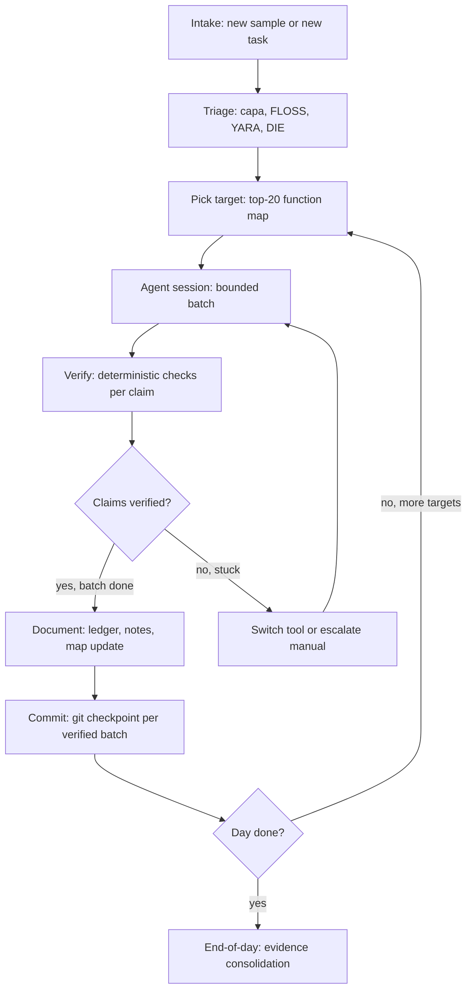

# Daily Workflows and Checklists

> Tags: workflow, session-management, evidence-ledger, timeboxing, checklists | Difficulty: Beginner-Intermediate | Prerequisites: a built sandbox (see `../01-setup/linux-sandbox-base.md`) and one decompiler bridge (see `../05-tools/mcp-catalog.md`)

## Overview

This page is the operating procedure for a working day with AI in the loop.
It assumes you already have a sandbox and one tool bridge.
The procedures here link out to the detail pages.

A good RE day has one shape: intake, triage, pick target, agent session, verify, document, commit.
The agent accelerates the middle of the day.
You control the front and the back.

Why a fixed loop matters:

- Agent context does not survive the night. The ledger does. See `../03-decomp/verification-loop.md` and `../02-collab/context-engineering.md`.
- Open-ended agent exploration fails. The measured guidance is bounded prompts with evidence requirements. The "find the vulnerability" prompt shape produced hallucinated buffer overflows and cost about 231 percent more wasted time in the NDSS-era studies summarized in `BASE_REPORT.md` section 16.
- Cost compounds across sessions. DecBench measured about $1.0-1.2 per function for gpt-6-astra and about $6.6 for claude-opus-4-8. Track spend per target.
- Half of cited functions in agent RE reports were wrong in a SentinelOne measurement. Verification is not optional.

## Setup

### Directory layout

Keep one git repository per engagement or per sample family.

```bash
mkdir -p ~/re-work/sample-001/{evidence,notes,export,session-logs}
cd ~/re-work/sample-001
git init
```

Inside the folder:

```text
triage.md            # triage record from the deterministic tools
map.md               # ranked function map (the "next twenty")
index.md             # progress checklist and stats, read first on session start
evidence/ledger.tsv  # one row per claim, never edited in place
export/functions/    # decompiled pseudocode, one file per function
notes/               # your own analysis notes and cross-function findings
session-logs/        # one markdown file per agent session
```

The `index.md` checklist and `ledger.tsv` are the only state that must survive compaction and overnight gaps.
See `../03-decomp/decompile-workflow.md` for the full layout and ledger schema.

### Tooling on day one

Confirm these before the first session. Do not debug tooling mid-task.

| Check | Command | Fix when it fails |
|---|---|---|
| Ghidra headless | `analyzeHeadless` runs a no-op project | Set `GHIDRA_HEADLESS_MAXMEM=8G`. See `../03-decomp/batch-decompilation.md` |
| IDA idalib | `idalib` opens a headless session | IDA 9.4 or later required for the official MCP |
| MCP bridge | one tool call through the MCP server | See `../05-tools/mcp-catalog.md` |
| capa rules | `capa -r <rules-dir>` returns hits | `pip install flare-capa` does not pull `mandiant/capa-rules` |
| FLOSS | `floss sample.exe` produces output | `pip install flare-floss` |
| Model access | one bounded prompt returns JSON | Check the model page in `../07-advanced/model-selection.md` |

Use Claude Opus 4.8 for RE work in 2026. Opus 5.5 reportedly halts RE requests mid-answer since about October 21, 2026. See `../07-advanced/model-selection.md`.

## Step-by-Step

### The day loop



### Step 1: Intake (5 minutes)

Intake is a decision, not analysis.
Answer three questions and write them at the top of `index.md`:

1. What is the deliverable? Examples: a triage report, a named function map, a recovered protocol, a license-check bypass.
2. What is the trust level of the binary? Malware, packed, or hostile gets isolation rules from `../07-advanced/ai-security-threats.md`.
3. What is the time budget? Set the batch size and the stop rule now, not later.

Do not start an agent session on an unsandboxed untrusted binary.
See `../01-setup/malware-isolation.md`.

### Step 2: Triage (15-45 minutes)

Run the deterministic tools from `../03-decomp/triage-and-mapping.md`. The full command list lives there.
Minimum set:

```bash
file sample.exe
diec sample.exe
sha256sum sample.exe > sha256.txt
strings -a -n 6 -t x sample.exe > strings-offsets.txt
floss sample.exe > floss.txt
capa -j -r ~/capa-rules-10.0.0 sample.exe > capa.json
yara -r ~/rules/ sample.exe > yara-hits.txt
```

Write `triage.md`. Every claim in it traces to a tool output in the same folder.
If DIE or capa flags a packer, stop. Switch to `../06-topics/deobfuscation.md` and the unpacking path before mapping.

### Step 3: Pick the target (the map)

Build `map.md` per `../03-decomp/triage-and-mapping.md` step 10.
The map holds the top twenty candidate functions with scores and evidence.
The agent only sees the queue. Never the whole binary.

### Step 4: Agent session (the bounded batch)

One session covers one batch. The recommended batch is 5 to 20 functions for interactive naming work, up to 50 for pure export-style tasks. See the timeboxing rules below.

Start the session with the resume prompt:

```text
Read index.md and evidence/ledger.tsv in the current directory.
Summarize progress in 5 bullets.
Then work on the next pending batch in the map queue.
Do not re-analyze functions already marked verified in the ledger.
Do not write comments back into the decompiler database.
```

The last rule matters. Persistent comment injection from hostile binaries is documented. See `../07-advanced/ai-security-threats.md`.

Give the agent the bounded task prompt:

```text
Sample: sample-001 (sha256 in triage.md)
Read triage.md and map.md first.
Work on functions #<start> through #<end> in the priority queue.
For each function:
1. Report the decompiled pseudocode path.
2. Propose a name and a one-line purpose.
3. List every import and string it references.
4. Flag anything that contradicts the map evidence.
Do not analyze functions outside the queue.
Do not speculate about authorship or campaign.
Return structured output only.
```

Ask for JSON where possible. Structured output is easier to verify mechanically.

End every session with a session log before the context dies:

```bash
cat > session-logs/2026-11-05-s1.md <<'EOF'
# Session s1 — 2026-11-05

- Batch: map rows 1-10
- Agent: Claude Code + Ghidra MCP
- Model: Claude Opus 4.8
- Done: 10 functions decompiled, 7 named, 4 verified
- Blocked: FUN_140003D00 — indirect calls unresolved
- Next: rows 11-20, then resolve FUN_140003D00 pointer table
- Spend: ~80k tokens
EOF
```

Update `index.md` stats and the phase checklist in the same commit.

### Step 5: Verify

Run the verification loop from `../03-decomp/verification-loop.md` on every claim before it counts.
Minimum bar per session:

- Every proposed function name has evidence: a string, an import, or a constant.
- Every address or string claim re-derives from the binary with a deterministic tool. `re-ground` (github.com/shouvikkkk/re-ground) automates this pattern.
- Verdicts land in `evidence/ledger.tsv` as VERIFIED, REFUTED, or INCONCLUSIVE. Never edit an old verdict. Append a superseding row.

A claim with no evidence is INCONCLUSIVE by definition.

### Step 6: Document

Write findings into `notes/`, not into chat.
Cross-function findings go in `notes/protocols.md` or `notes/architecture.md`.
Update `map.md` statuses: pending, named, decompiled, verified, blocked.

### Step 7: Commit

Commit after every verified batch, not at end of day.

```bash
git add -A
git commit -m "batch 1-10: 7 named, 4 verified, ledger updated"
```

A commit per batch gives you rollback when the agent writes garbage into a file.
It also timestamps the ledger, which matters when you reconstruct what the model saw.

### End-of-day evidence consolidation

Reserve the last 20 minutes of the day for this. Do it every day, even on short days.

1. Run the ledger audit:

```bash
awk -F'\t' '{print $4}' evidence/ledger.tsv | sort | uniq -c
```

2. List every INCONCLUSIVE claim in a `notes/open-questions.md` file with the evidence still missing.
3. Update `index.md`: stats, phase checklist, next session's first task.
4. Write the final session log entry.
5. Commit: `git commit -m "eod: ledger audit, open questions, index update"`.
6. If the sample is untrusted, snapshot the VM. See `../01-setup/malware-isolation.md`.

The audit catches two failure modes: claims that were never verified, and verified claims that never made it into `notes/`.

## Task-type checklists

### Checklist: new binary (first look)

Use this when a sample lands with no context.

- [ ] Hash recorded in `triage.md`.
- [ ] `file`, `diec`, `readelf -h` or `objdump -x` run. Format confirmed.
- [ ] Packer check: DIE plus capa plus section names. If packed, switch to deobfuscation first.
- [ ] Strings harvested: `strings -a -n 6 -t x`, plus FLOSS for PE.
- [ ] capa run with explicit rules path. Top-level capabilities recorded.
- [ ] YARA sweep against pinned rule repos.
- [ ] Entry points identified: AddressOfEntryPoint, TLS callbacks, DllMain, exports.
- [ ] High-signal imports grouped and xrefs located.
- [ ] Top-20 map built with scores and evidence.
- [ ] First agent batch scoped to 5-10 functions.
- [ ] Ledger exists and has at least one row.
- [ ] `index.md` written with stats and next task.

### Checklist: new protocol

Use this when the target is a wire protocol, file format, or IPC channel.

- [ ] Capture or sample obtained: PCAP, firmware dump, or harness-built traffic.
- [ ] Sample count recorded. One capture is a lead. Ten captures show variance.
- [ ] Deterministic preprocessing done first: `tshark -T fields`, `binwalk`, Kaitai struct if format is known.
- [ ] Field hypotheses written to `notes/protocol-fields.md` before any agent call.
- [ ] Agent session bounded to "name these fields" or "diff these two messages", not "reverse this protocol".
- [ ] Replay or fuzz verification planned: send the candidate bytes, compare responses.
- [ ] Grammar or parser draft committed separately from analysis notes.
- [ ] Unknown fields kept as `field_NN` until two independent observations agree.

See `../06-topics/protocol-reverse.md` for the full protocol pipeline and tools (Substrat, ProtoForge, Kaitai).

### Checklist: new firmware

Use this when the target is a router, IoT device, or embedded blob.

- [ ] Firmware image hashed and archived read-only.
- [ ] Extraction attempted: Binwalk v3 or unblob. Carved files listed with offsets.
- [ ] Kernel identified: `vmlinux-to-elf` if a compressed kernel was found.
- [ ] Architecture confirmed: ARM, ARM64, MIPS. Endianness recorded.
- [ ] Filesystem mounted read-only. Web UI assets and binaries separated.
- [ ] Entry points mapped: init scripts, httpd handlers, CGI binaries, update mechanisms.
- [ ] Facts extracted to a queryable store before agent analysis. The ripcord pattern uses Parquet to DuckDB.
- [ ] Headless decompile export run per binary found. See `../03-decomp/batch-decompilation.md`.
- [ ] Hardware oracle available if needed: Unicorn or Renode. See `../06-topics/firmware-iot-re.md`.
- [ ] UART/JTAG access documented if physical access is in scope. flashprobe-mcp exists for this.
- [ ] Credentials and default configs checked before deep RE. Half of IoT findings are config bugs.

## Timeboxing rules

These rules keep the agent from eating the day. Apply them per session.

### Agent exploration budget

- 20 minutes per bounded batch. If the agent has not produced structured output by then, stop and check the session log.
- 3 passes per stuck function. After three failed attempts, the answer is probably in runtime behavior, not the decompiler. Switch to dynamic tools. See `../03-decomp/decompile-workflow.md` "When to Stop and Hand Off".
- 1 open-ended question per day, maximum. "Find the vulnerability" is not a bounded task.
- 50 functions per prompt ceiling. Larger batches cause greedy fetching and context saturation.

### Manual work budget

- Triage is manual-first. Deterministic tools before any model call.
- Verification is always manual-controlled. The agent never marks its own work verified.
- Map building is deterministic. Score with rules, not vibes.
- Documentation is human-written. The agent drafts. You edit.

### Switching rules

Switch tools when the signal fires, not when you get bored.

| Signal | Switch to |
|---|---|
| Decompiler output is garbage for a whole region | Dynamic: x64dbg, Frida, or a VM-aware sandbox |
| Cannot explain a function after 3 agent passes | Frida hook or debugger breakpoint |
| Packed or self-modifying code | Unpack first, re-import the dump |
| Anti-debug or anti-VM detected | Run in a VM. See `../07-advanced/anti-analysis.md` |
| Need a concrete input to reach a path | angr, Triton, or Qiling for the bounded path |
| Claim stays INCONCLUSIVE after re-checks | Dynamic trace to settle it |
| Agent contradicts itself across sessions | Fresh session with ledger resume prompt. Do not argue with it |

### Session sizing

| Task type | Batch size | Session length |
|---|---|---|
| Function naming | 10-20 functions | 30-45 min |
| Bulk decompile export | 50 functions | 20 min, mostly unattended |
| Type recovery | 5-10 functions | 30 min |
| Protocol field naming | 1 message format | 30 min |
| Malware triage summary | 1 sample | 20 min |
| Documentation draft | 1 section | 20 min |

## Pitfalls

- Do not start the agent before `triage.md` and `map.md` exist. Unguided sessions produce plausible fiction.
- Do not skip the end-of-day consolidation. Context compaction cut input tokens by about 86 percent in the SentinelLABS study but degraded recovery of higher-level objects. The ledger is the fix.
- Do not let one session sprawl across two targets. Close the session log, commit, then switch.
- Do not trust agent memory across sessions. Resume from `index.md` and `ledger.tsv` every time.
- Do not feed raw assembly to the model. Feed decompiler pseudocode.
- Do not ask open-ended questions. Bound the scope, demand evidence, require JSON.
- Do not let the agent write to the decompiler database during untrusted-binary sessions. Persistent injection is documented.
- Do not commit unverified claims as fact. INCONCLUSIVE stays INCONCLUSIVE until a deterministic check settles it.
- Do not batch more than 50 functions per prompt.
- Do not use Opus 5.5 for RE work in late 2026. Use Opus 4.8 or another frontier model.
- Do not compare cost across tools without logging tokens. DecBench showed per-function cost varies by an order of magnitude between models.
- Do not treat REA or any harness as a silver bullet. Independent evaluations found no significant solve-rate gain over plain agents at about 2x cost. Use harnesses for structure, not magic.
- Do not skip `git commit` after a verified batch. The commit is your undo point.
- Do not run the sample on the host. Sandbox first. See `../01-setup/agent-sandboxing.md`.

## See Also

- `../03-decomp/triage-and-mapping.md` — the triage and map steps this workflow runs
- `../03-decomp/decompile-workflow.md` — the per-function loop and output layouts
- `../03-decomp/verification-loop.md` — deterministic verification of every claim
- `../03-decomp/batch-decompilation.md` — headless export pipelines for bulk work
- `../03-decomp/decomp-orchestration.md` — when to scale from one agent to a swarm
- `../02-collab/context-engineering.md` — surviving compaction across sessions
- `../02-collab/multi-agent-patterns.md` — orchestrator, verifier, and debate patterns
- `../05-tools/mcp-catalog.md` — the bridges this workflow assumes
- `../06-topics/protocol-reverse.md` — protocol RE specifics
- `../06-topics/firmware-iot-re.md` — firmware extraction and rehosting
- `../07-advanced/model-selection.md` — model choice and cost per task
- `../07-advanced/ai-security-threats.md` — isolation rules for hostile binaries
- `../08-case-studies/real-world-recipes.md` — end-to-end examples of this loop
