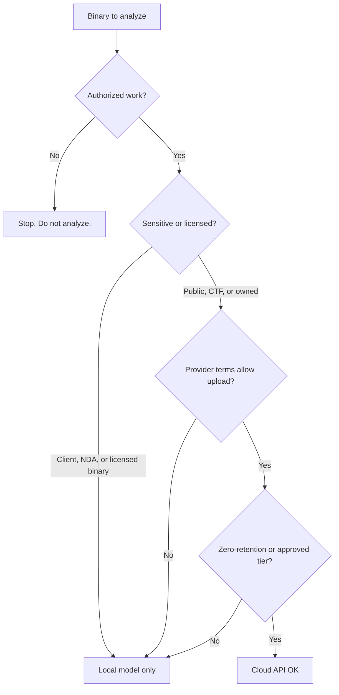

# Legal and Ethical Boundaries for RE

> Tags: legal, ethics, dmca, cfaa, license, cloud | Difficulty: intermediate | Prerequisites: `../00-fundamentals/binary-formats.md`, `05-tools/tool-catalog.md`

Reverse engineering is legal in most jurisdictions for some purposes. It is illegal in most jurisdictions for other purposes. This page maps the boundaries you will hit in daily work: the DMCA anti-circumvention rules and their exemptions, the CFAA after Van Buren, the EU decompilation allowance, Japan and Korea positions, license clauses that override statute, and the practical rules for cloud AI uploads. It is not legal advice. For high-stakes targets, ask a lawyer.

## Overview

Four legal layers can reach your RE work:

1. **Copyright law.** Decompiling produces a copy of the work. Fair use and statutory exemptions decide if that copy is lawful.
2. **Anti-circumvention law.** DMCA section 1201 and equivalents punish bypassing DRM and license checks, even when the underlying use would be fair.
3. **Computer crime law.** The CFAA and equivalents punish unauthorized access. Downloaded files are usually safe. Live systems you do not own are not.
4. **Contract law.** EULAs and terms of service can forbid reverse engineering even where copyright law permits it. Breach of contract is a separate claim.

A fifth layer is yours: ethics and OPSEC. Publishing client decompilations, uploading proprietary binaries to cloud APIs, and sharing cracks all create real-world harm that statutes do not always cover.

The bright lines at the end of this page are the operational core. Read them first if you are in a hurry.

## How It Works

### United States: DMCA section 1201

17 U.S Code section 1201 makes it unlawful to "circumvent a technological measure that effectively controls access to a work" (section 1201(a)(1)(A)). It separately bans manufacturing or trafficking in circumvention tools (section 1201(a)(2), section 1201(b)). Text: https://www.law.cornell.edu/uscode/text/17/1201

Key points for RE work:

- The prohibition targets access controls, not copy controls. A DRM scheme that blocks reading the binary is covered. A license key check inside software you already run is murkier.
- Trafficking is the dangerous half. Distributing a keygen, a patched binary, or a circumvention script is what gets prosecuted. Private analysis is a different risk profile.
- Exemptions exist but are narrow. The statute itself contains three:

| Exemption | Section | Condition |
|---|---|---|
| Security research | 1201(j) | Good faith. Solely to identify and analyze flaws or vulnerabilities. No trafficking in the circumvention tool or knowledge |
| Interoperability | 1201(f) | Lawful copy. Good-faith belief that reverse engineering is necessary to achieve interoperability with an independently created program |
| Encryption research | 1201(g)-(j) | Published cryptographic research, advance notice to the copyright holder |

- The Librarian of Congress adds exemptions every three years through rulemaking. The ninth cycle closed in 2024. Renewed exemptions run through October 2030. See https://www.copyright.gov/1201/ and https://www.copyright.gov/1201/2024/. Past cycles added exemptions for security research on lawfully acquired devices, smartphones, smart TVs, and medical devices, and for text and data mining.
- The rulemaking process matters. If your use does not fit a current exemption, you can petition for the next cycle. That takes years. Do not build a workflow that depends on a pending petition.

### United States: CFAA after Van Buren

The Computer Fraud and Abuse Act (18 U.S. Code section 1030) punishes accessing a computer "without authorization" or "exceeding authorized access". The Supreme Court resolved the second phrase in *Van Buren v. United States*, 593 U.S. 374 (2021): exceeding authorized access means accessing a part of the system you are not entitled to reach, not misusing information you are entitled to see. Text and opinion: https://www.law.cornell.edu/supremecourt/text/18-96

What this means for RE:

- Running a suspicious binary inside your own VM or sandbox is analysis of a file, not access to a computer. Low CFAA risk.
- Connecting to a live service, probing an endpoint, or pulling data from infrastructure you do not own or lack permission for is CFAA territory. High risk.
- Jailbreaking or instrumenting a device you own is generally treated differently from doing it to someone else's device, though DMCA anti-circumvention can still apply.
- "I found it on a forum" is not authorization. The downloader's rights do not transfer to you.

### European Union: Software Directive decompilation allowance

Directive 2009/24/EC on the legal protection of computer programs harmonizes copyright rules for software across the EU. Article 6 permits decompilation to obtain interoperability information when three conditions hold: you have lawful access to the program, the information is not already available, and the decompilation is restricted to what is necessary. The information may be used only for interoperability. Text: https://eur-lex.europa.eu/legal-content/EN/TXT/?uri=CELEX:32009L0024

Key points:

- This is a copyright allowance, not a blanket right. It exists for interoperability. It does not legalize cracking a license check for convenience.
- Contract law interacts. Member states differ on whether a license clause can forbid decompilation that Article 6 permits. Several jurisdictions treat the interoperability right as overriding contrary contract terms for that narrow purpose. Unverified per member state. Check local counsel.
- The Database Directive (96/9/EC) adds a sui generis database right. Extracting a substantial part of a protected database is infringement even if each element is uncopyrightable. RE of a binary that embeds a database can hit this.
- The DSM Directive (2019/790) added text and data mining exceptions (Article 3, Article 4). Security research has a dedicated carve-out in Article 3(2). These help research workflows but do not replace the software-specific analysis.

### Japan

Japan's Copyright Law contains two relevant provisions, both from the 2018 amendments:

- Article 30-4 permits use of copyrighted works for "information analysis" including machine learning, without the author's permission, to the extent it does not infringe the author's legitimate interests.
- Article 47-4 permits reproduction of a computer program to the extent necessary for understanding its operation, for the purpose of developing interoperable programs or correcting defects, again limited by the author's legitimate interests.

Circumvention of technological protection measures is separately regulated (Article 30-1(2) and the Anti-Circumvention provisions). Private security research sits in a gray zone; distribution of circumvention tools does not. Source text: https://www.cric.or.jp/english/cld/db-bun/data/c11905.html (unofficial translation; verify against the Agency for Cultural Affairs text before relying on it).

### South Korea

Korea's Copyright Act regulates circumvention of technological protection measures and permits circumvention for research, analysis, or interoperability purposes under conditions (Articles 101 and 35-5 of the English translation at https://www.law.go.kr). Korea also allows research use exceptions similar to Japan's information-analysis provision. Details are unverified in this wiki. Read the statute text directly before acting.

### License terms that prohibit RE

Copyright exemptions do not void contract. A EULA or terms of service can forbid reverse engineering, decompilation, or derivative works. Violating that clause is breach of contract even when the underlying analysis would be fair use.

Practical consequences:

- Commercial software under a strict EULA: the license binds you as a user. Analysis for interoperability may still be protected in the EU. In the US, contract claims are usually weaker than copyright claims but not zero.
- Shrink-wrapped and click-through licenses are enforceable in most US states if notice is reasonable.
- Open source licenses rarely forbid RE but impose copyleft on derivatives. GPL-licensed firmware you decompile and republish may have to be GPL-licensed back.
- "No reverse engineering" clauses in consumer ToS are common and mostly untested in court. Reported enforcement is rare, but the clause exists and vendors do assert it.
- Employment and NDA agreements can forbid RE of anything you touch at work, including your own side projects on employer-provided binaries.

### The bright lines

These rules are safe harbors in practice. They are not legal advice, but breaking them is how people get sued.

1. **Do not distribute cracks.** No keygens, no patched binaries, no circumvention scripts, no "fixed" license checks posted anywhere. Trafficking in circumvention tools is the prosecuted offense under DMCA 1201(a)(2) and equivalents.
2. **Do not target systems you do not own.** Live probing, exploitation, and data extraction from third-party infrastructure is CFAA territory regardless of intent. Analyze files. Do not touch networks.
3. **CTF, lab, and owned targets are safe.** Crackmes, pwn.college, picoCTF, your own firmware, hardware you bought: analyze freely. Document that the target is yours or the event is authorized.
4. **Interoperability is a real defense, not a loophole.** If your goal is to make your own program talk to theirs, document that goal before you start.
5. **Security research must be good faith and quiet.** Identify the flaw, report it to the vendor, do not publish the exploit before a fix window. DMCA 1201(j) requires good faith.
6. **Read the license before you decompile.** If the EULA forbids it, assume the vendor will assert breach of contract. Weigh that against your purpose.
7. **Do not publish client decompilations.** Work product belongs to the client under most engagement terms. Publishing it is both a contract breach and a copyright problem.

## Step-by-Step

### Step 1: Run the authorization check

Before you open a binary, answer these questions in writing:

| Question | If yes | If no |
|---|---|---|
| Did you write this binary? | Proceed. Document ownership. | Continue |
| Do you have written authorization? | Proceed. File the letter. | Continue |
| Is this a CTF, lab, or training target? | Proceed. Note the event rules. | Continue |
| Is this open source under a license that permits RE? | Proceed. Check copyleft duties. | Continue |
| Is your goal interoperability or security research? | Proceed. Document the purpose. | Continue |
| Is the binary downloaded for personal study? | Proceed. Fair use likely covers private analysis. | Stop |
| Are you distributing anything derived? | Stop. Trafficking risk. | — |
| Are you touching a live system you do not own? | Stop. CFAA risk. | — |

If the last two rows apply, stop. No exemption covers distribution of circumvention tools or unauthorized access to live systems.

### Step 2: Document the authorization

Create an authorization record for every engagement. Store it with the case files.

Template:

```text
ENGAGEMENT: <client or project name>
DATE OPENED: <YYYY-MM-DD>
TARGET: <binary name, version, SHA-256>
SOURCE: <how obtained: purchased, client-provided, downloaded, CTF>
PURPOSE: <interoperability | security research | malware analysis | personal study | other>
AUTHORIZATION:
  - <name>, <role>, <date>, <scope granted>
  - evidence: <email, contract clause, license text, screenshot>
LICENSE REVIEW:
  - EULA/ToS reviewed: <yes/no>
  - RE clause: <quote or "none found">
CLOUD POLICY:
  - binary may leave local machine: <yes/no>
  - approved providers: <list>
  - model tier: <API | local>
NOTES: <anything unusual>
```

For purchased software, keep the receipt and the license text. For client work, keep the statement of work or email authorizing the analysis. For CTF, screenshot the rules page. For open source, archive the license file with the repo.

### Step 3: Check the license before deep work

Do this before you spend hours in Ghidra:

```bash
# Look for license and EULA files in an extracted package
find . -maxdepth 3 -iname 'LICENSE*' -o -iname 'EULA*' -o -iname 'TERMS*' -o -iname 'COPYING*' | head -20

# Check the binary's embedded license strings
strings -n 8 target.bin | grep -inE 'reverse engineer|decompil|license|eula|terms of service' | head -30
```

If a EULA forbids RE, decide explicitly: proceed and accept contract risk, or decline. Do not discover the clause after you have already published findings.

### Step 4: Decide the cloud question before the agent question

Uploading a binary to a cloud model API sends the bytes to a third party. That can violate the target's license, leak client data, or breach your own confidentiality obligations. Decide before you configure the agent.



Rules for cloud uploads:

- Read the provider's data usage terms. API tiers differ from consumer tiers. OpenAI API, Anthropic API, and Google Vertex each have different retention and training defaults. Check current terms; they change.
- Assume prompts and responses are logged for some period even on paid tiers. Zero-retention agreements exist for enterprise tiers on some providers. Verify before relying on them.
- Never upload binaries you are under NDA for, client deliverables, or licensed software whose EULA forbids third-party disclosure.
- Prefer local models for anything sensitive. The 2026 local options (reported): Qwen3-Coder, DeepSeek-Coder-V2, CodeLlama variants on a consumer GPU. Quality is below frontier cloud models for hard RE. See `07-advanced/model-selection.md`.
- If you must use cloud, strip metadata first: build ID, PDB path, embedded URLs, serial numbers. A clean binary leaks less.

### Step 5: Keep the publication gate

Before you publish anything derived from the binary:

- Decompilation output is a derivative work of the original. Publishing it can infringe copyright even if your analysis was fair use.
- PoC exploits for vulnerabilities you discovered: follow coordinated disclosure. Report to the vendor, wait for a fix window, then publish.
- Tool releases that circumvent protection: this is trafficking. Do not publish.
- Client work: the contract usually assigns work product to the client. Publishing requires their written permission.

## Pitfalls

- **Assuming "I own the binary" means "I can do anything".** Copyright exemptions are purpose-limited. Owning a copy does not give you the right to distribute cracks or access systems you do not own.
- **Confusing the exemption from the prohibition.** DMCA 1201(j) exempts security research from the anti-circumvention ban. It does not exempt you from copyright infringement if you distribute the software you cracked.
- **Treating the CFAA as dead after Van Buren.** Van Buren narrowed "exceeds authorized access". It did not legalize hacking. Accessing systems without authorization is still a crime.
- **Ignoring the contract layer.** A EULA can forbid RE even where statute permits it. The vendor can sue for breach of contract. This is rare but real.
- **Uploading to the wrong model tier.** Consumer chat tiers often train on prompts. API tiers usually do not, but retention varies. Check the specific terms for the specific provider and tier you use.
- **Publishing decompiled source.** A full decompilation is a derivative work. Publishing it is copyright infringement in most cases even if your analysis was fair use.
- **Believing CTF rules override law.** A CTF authorizes attacks on the challenge infrastructure. It does not authorize attacking the CTF platform itself or third parties.
- **Skipping documentation.** Without an authorization record, you cannot prove good faith after the fact. The record is cheap. The lawsuit is not.
- **Assuming open source means no restrictions.** GPL and AGPL impose copyleft on derivatives. Decompiling GPL firmware and publishing the result may require GPL-licensing your output.
- **Using "security research" as a blanket excuse.** The exemption requires good faith and a genuine vulnerability-analysis purpose. "I wanted to see how it works" is not security research.

## See Also

- `../01-setup/malware-isolation.md` — safe detonation and sandboxing for hostile samples
- `../01-setup/network-isolation.md` — egress control to prevent accidental access to live systems
- `../01-setup/agent-sandboxing.md` — isolating the agent from the binary and from your credentials
- `../03-decomp/verification-loop.md` — deterministic verification of agent output before publication
- `../06-topics/malware-analysis.md` — malware triage workflow and IOCs
- `../07-advanced/model-selection.md` — local vs cloud model tradeoffs and cost
- `../07-advanced/ai-security-threats.md` — prompt injection and MCP supply-chain risks when AI reads hostile binaries
- `../05-tools/tool-catalog.md` — decompiler and debugger inventory with license notes
