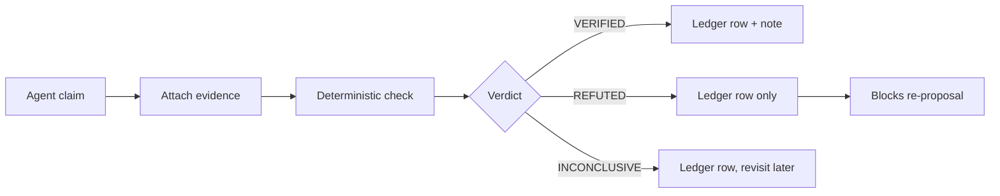
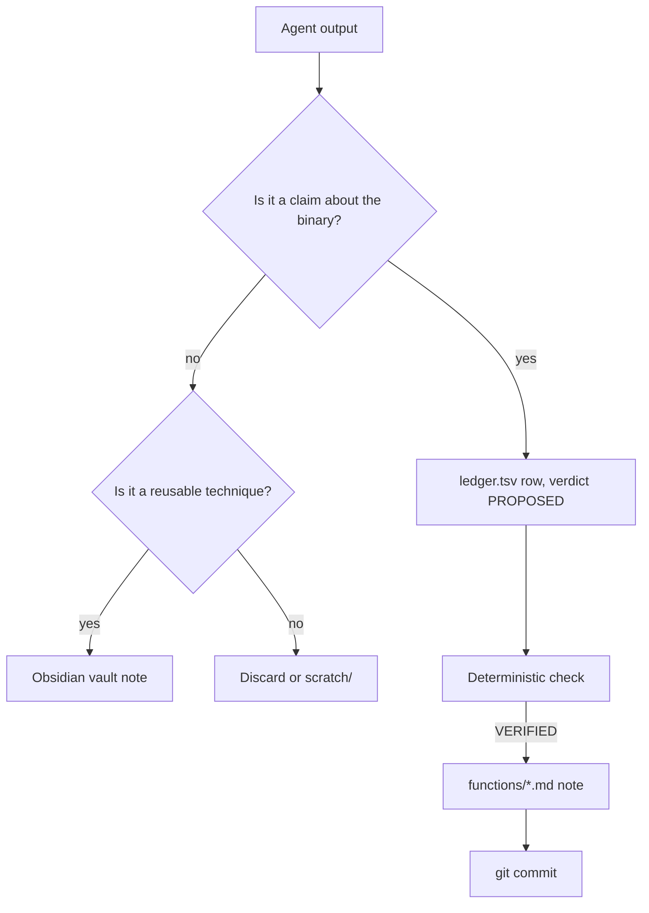

# Notes, Evidence, and Project Hygiene

> Tags: notes, evidence-ledger, file-organization, obsidian, git, naming, documentation, session-handoff | Difficulty: Intermediate | Prerequisites: one target binary or firmware image under analysis, one decompiler (Ghidra 12.2, IDA 9.5, or Binary Ninja 6.0) or a Frida session, an LLM agent harness

## Overview

Reverse engineering with AI produces output faster than you can read it. The output is also unverified, partial, and written against a specific model and toolchain state.

In six months you will return to this work. The model will be different. The MCP server will have a new version. The context that made a conclusion obvious will be gone. What remains is whatever you wrote to disk.

This page covers how to write that disk state so it survives:

- the evidence ledger pattern: claim to evidence to verdict
- file organization conventions that let both you and the agent find things
- an Obsidian vault layout for cross-target knowledge
- git commit policy: what belongs in version control and what never does
- naming conventions that stay meaningful across six-month gaps
- converting agent output into durable notes
- the "future you" test

The core principle: an agent's chat output is ephemeral. Notes are the deliverable. Treat every analysis session as producing two artifacts: findings about the binary, and improvements to your note system.

## How It Works

### The evidence ledger pattern

Every AI-derived claim enters the record through the same pipeline:

1. The agent makes a claim.
2. You attach evidence: an address, a byte offset, a tool output file, a screenshot.
3. A deterministic check or a human review assigns a verdict.
4. The ledger stores claim, evidence, verdict, and date.
5. Verified claims graduate into notes. Refuted claims stay in the ledger so nobody re-proposes them.



Three structures carry this pattern. Use at least one per project.

**`ledger.tsv`** — the flat file. One row per claim. Columns:

```text
claim_id	func_addr	claim_type	claim	verdict	evidence	model	session	date
c-014	0x4012F0	name	reg_write_run_key	VERIFIED	RegSetValueExA on HKCU Run key	claude-opus-4.8	s1	2026-11-05
```

Rules for the flat ledger:

- One row per claim. Never edit a verdict. Append a superseding row.
- Evidence must point to something checkable: an address, a string, an offset, a tool output file.
- A claim with no evidence is INCONCLUSIVE by definition.
- Refuted claims stay. They are the cheapest hallucination filter you have.

**Per-function markdown files** — the human layer. Each function gets a file with a fixed template:

```markdown
# 0x004012F0 — reg_write_run_key

- Address: 0x004012F0
- Status: verified | partial | blocked
- Named by: deterministic | llm-pass1 | human | claude-opus-4.8

## Pseudocode
<link to .c file>

## AI proposals
| Item | Proposal | Verdict | Evidence |
|---|---|---|---|
| name | reg_write_run_key | verified | RegSetValueExA on HKCU\...\Run |

## Notes
<your own observations>
```

**SQLite store** — the scale layer. When a binary has thousands of functions or multiple sessions write results, use a database. The decomp-orchestration page covers the `work_items` and `checkpoints` tables. Add a `claims` table with the same columns as the TSV:

```sql
CREATE TABLE claims (
  id INTEGER PRIMARY KEY AUTOINCREMENT,
  func_addr TEXT,
  claim_type TEXT,      -- name|type|behavior|constant
  claim_text TEXT,
  verdict TEXT,         -- verified|refuted|inconclusive
  evidence TEXT,
  model TEXT,
  created_at TEXT
);
```

Markdown for human reading. SQLite for claims and status. Files for pseudocode.

### Verdict vocabulary

Use one shared vocabulary across the ledger, the notes, and the agent prompts:

| Verdict | Meaning |
|---|---|
| VERIFIED | A deterministic tool confirmed it. Evidence file exists. |
| GROUNDED | The bytes, string, or import exist in the binary. The interpretation may still be wrong. |
| REFUTED | A deterministic tool disproved it. Record the counter-evidence. |
| UNGROUNDED | An audit found no trace of the claim in the binary. |
| INCONCLUSIVE | The check could not decide. Static-only checks on packed code land here. |
| PROPOSED | The agent suggested it. Nothing has checked it yet. |

Confidence and verdict are different axes. VERIFIED is a verdict. HIGH, MEDIUM, LOW is confidence in the interpretation. A GROUNDED address with an invented purpose is MEDIUM at best. Bytes confirmed, meaning assumed.

## Setup

### File organization: one directory per sample

The `/work` layout from `../01-setup/linux-sandbox-base.md` gives you the top level. Inside `analysis/`, use one directory per sample:

```
/work/analysis/
└── sample-2026-11-05_suspicious.exe/
    ├── triage.md            # first-look output: imports, strings, capa hits
    ├── map.md               # ranked function queue for agents
    ├── index.md             # progress checklist and stats
    ├── ledger.tsv           # every claim and its verdict
    ├── session-log.md       # dated session entries
    ├── functions/           # per-function notes
    │   ├── 004012F0_reg_write_run_key.md
    │   └── ...
    ├── pseudocode/          # exported .c files, one per function
    ├── prompts/             # exact prompts sent to models
    ├── evidence/            # reverify JSON, screenshots, packet captures
    └── notes/               # cross-function findings: protocols.md, overview.md
```

Rules:

- `triage.md` and `map.md` are agent inputs. Keep them current. A stale map makes agents re-do finished work.
- `ledger.tsv` is the source of truth for what is verified. Notes are the human-readable layer on top.
- `prompts/` stores what you actually sent. Six months later you will need it to reproduce a surprising result.
- `evidence/` holds only reproducible artifacts. Raw tool dumps go in `scratch/` or stay in the decompiler project.
- One sample per directory. Never merge two targets into one note tree.

### Obsidian vault structure

For knowledge that spans targets — techniques, tool quirks, protocol facts — use an Obsidian vault. Keep it separate from per-sample directories. Samples are ephemeral. Techniques are durable.

```
vault/
├── 00-inbox/               # raw captures, unprocessed agent output
├── 01-techniques/          # reusable methods: "unpacking UPX", "frida-hook-x"
├── 02-tools/               # per-tool notes: ghidra-12-quirks, ida-mcp-gotchas
├── 03-targets/             # one note per binary family or campaign
│   ├── evil-example-malware/
│   └── smart-tv-firmware/
├── 04-concepts/            # protocol specs, file format notes, crypto constants
├── 05-sessions/            # dated session summaries, links to sample dirs
└── templates/
    ├── function-note.md
    ├── technique-note.md
    └── session-note.md
```

Note conventions:

- File names use lowercase-kebab-case: `ghidra-12-typedef-recovery.md`, not `Ghidra Notes Final v2.md`.
- Every note has YAML frontmatter:

```yaml
---
type: technique
targets: [upx, ghidra]
tools: [ghidra-12.2, ida-9.5]
verified: 2026-11-05
confidence: HIGH
evidence: /work/analysis/sample-001/evidence/
tags: [unpacking, pe]
---
```

- Link with `[[wikilinks]]`. Obsidian resolves them across the whole vault. `[[upx-unpacking]]` survives file moves.
- Keep the vault out of the sample directory. Sample dirs get deleted or archived. The vault compounds.
- Agent harnesses read markdown fine. Point the agent at a vault note the same way you point it at `map.md`.

Do not put secrets in the vault. API keys, target credentials, and client names belong in a password manager, not in notes an agent can read.

## Step-by-Step

### Step 1: Start a session with a state read

Before any analysis, the agent reads the durable state:

```text
Read index.md, ledger.tsv, and session-log.md in the current directory.
Summarize progress in 5 bullets: what is verified, what is pending,
what failed last session, what is next.
Do not re-analyze functions already marked VERIFIED in the ledger.
```

This is the cheapest possible context-engineering win. The ledger replaces the compaction summary you no longer have.

### Step 2: Convert agent output into notes

Agent chat output is not a note. Run this conversion on every session's output before you close the session:

1. Extract claims. Anything the agent asserted about the binary becomes a ledger row with verdict PROPOSED.
2. Attach evidence. For each claim, point at the address, offset, or tool output that supports it. If you cannot point at anything, the verdict stays PROPOSED.
3. Check the cheap claims deterministically. `reverify verify` for address and byte claims. `re-ground audit` for report-level claims. See `../03-decomp/verification-loop.md`.
4. Write the human layer. Graduate verified claims into per-function notes and cross-function notes.
5. Log the session. Add a dated entry to `session-log.md`: what ran, what failed, what is next.

The conversion is manual the first few times. After that, write a small script. The report's `re-ground` tool converts report claims to its JSON schema mechanically. Reuse that pattern.

### Step 3: Commit analysis state to git

Version control the notes, not the binaries. A git repo per analysis root works well:

```bash
cd /work/analysis
git init
cat > .gitignore <<'EOF'
targets/
*.exe
*.dll
*.bin
*.elf
*.apk
*.gz
*.zip
pseudocode/
scratch/
*.i64
*.gpr
*.rep
EOF
git add -A && git commit -m "triage: initial map and ledger for sample-001"
```

What to commit:

- `triage.md`, `map.md`, `index.md`, `ledger.tsv`, `session-log.md`
- `functions/*.md` notes
- `notes/*.md` cross-function findings
- `prompts/` — the exact prompts, for reproducibility
- `evidence/` text artifacts: reverify JSON, capa output, YARA hits
- `.gitignore`, `CONVENTIONS.md`, helper scripts under `scripts/`

What never to commit:

- Sample binaries, firmware images, APKs, memory dumps. They are large, often sensitive, and sometimes illegal to redistribute.
- Ghidra project files (`*.gpr`, `*.rep`, project directories). They are binary blobs. Regenerable from the sample.
- IDA databases (`*.i64`, `*.id0`–`*.id2`, `*.nam`, `*.til`). Large, binary, tool-version-locked.
- Screenshots and packet captures over a size threshold. Commit text summaries instead. Keep the raw artifacts in `evidence/` on disk.
- Anything containing real credentials, victim data, or client-confidential material.
- Live API keys in agent configs. `.env` files stay out of git entirely.

Commit cadence:

- Commit after every verified batch, not every agent message.
- Commit message format: `<phase>: <what changed>`. Example: `name: batch 7 verified, 12 functions`, `fix: refuted c-031 beacon_send claim`.
- One commit per logical change. The ledger makes diffs readable.
- Before a long unattended swarm run, commit. The swarm's ledger is the checkpoint. Git is the rollback.



### Step 4: Naming that survives six months

Three naming layers each need rules.

**Sample directories.** Use `target-YYYY-MM-DD_shortname.ext`:

```text
sample-2026-11-05_suspicious.exe
evil-example-2026-09-12_update.apk
router-fw-2026-10-30_1.4.2.bin
```

The date is when you got it, not when you analyzed it. The shortname is lowercase, kebab-case, under 30 characters. Never name a directory `final`, `new`, or `latest`. Those names rot.

**Function names in the decompiler database.** The naming rules from `../03-decomp/triage-and-mapping.md` apply: lowercase snake_case, verb-first for actions, domain prefixes, never encode an address in the final name. Two additions for longevity:

- Prefix agent-proposed names with `ai_` until verified, or track provenance in the ledger's `model` column. Either works. Pick one and stay consistent.
- Record the naming pass in `index.md`: `Named by: deterministic | llm-pass1 | human`.

**Ledger and note identifiers.** `c-NNN` claim IDs and `sN` session IDs stay stable forever. Never renumber. Append only.

**Obsidian note names.** Kebab-case, topic-first: `ida-mcp-execute-python-limits.md`, not `notes about the ida mcp thing.md`. Include the tool version when behavior differs by version: `ghidra-12-headless-gotchas.md`.

### Step 5: The future-you test

Before you close a session, read your notes as if you wrote them six months ago and forgot everything. For each note, ask:

- Can I find this note without remembering the session? If the path requires memory, rename it.
- Does every claim have a verdict and evidence pointer? If a claim is bare prose, it is PROPOSED at best.
- Would a different model reach the same conclusion from this note? If the note depends on chat context, it is incomplete.
- Are tool versions and dates recorded? "Ghidra" is ambiguous. "Ghidra 12.2, 2026-11-05" is not.
- Can I reproduce the result? If the note cites a prompt, the prompt is in `prompts/`. If it cites a tool output, the output is in `evidence/`.
- Is anything in here that would embarrass me or break policy if read by someone else? Secrets, credentials, and client data do not belong in notes.

A note that fails the test gets fixed before the session ends, not "later." Later is a myth. The session log entry is the cheapest fix: one paragraph saying what happened, what is verified, and what is next.

## Pitfalls

- **Notes that record conclusions without evidence.** "This function is the C2 sender" is worthless in six months. "This function is the C2 sender — VERIFIED via reverify r-014, references beacon.php at 0x4A2010" survives.
- **Committing binaries to git.** Sample EXEs, IDBs, and Ghidra projects bloat the repo and create legal exposure. `.gitignore` them on day one.
- **Renaming files mid-project.** If `map.md` references `functions/004012F0_*.md`, renaming the file breaks the agent's next read. Rename deliberately, update references in the same commit.
- **Letting the agent edit the ledger silently.** The agent proposes ledger rows. You or a deterministic script commits them. An agent that can rewrite its own verdicts will eventually mark hallucinations VERIFIED.
- **One giant notes file.** A single `analysis.md` that grows forever is unsearchable and unmergeable. Per-function files plus a small set of cross-cutting notes scales better.
- **Notes without dates.** Tool versions change. Model behavior changes. "Verified on 2026-11-05 with Ghidra 12.2" is a fact. "Verified" is not.
- **Treating chat history as documentation.** Agent chat logs are not durable, not searchable across sessions, and not readable by the next model. Export what matters to files.
- **Skipping `prompts/`.** When a result looks surprising, you will want to know exactly what you asked. Save the prompt. It costs nothing.
- **Obsidian vault inside the sample directory.** The vault is durable knowledge. Sample directories get archived or deleted. Keep them separate.
- **Committing `.env` or agent credentials.** `.gitignore` them. API keys in a public or shared repo are a breach, not a convenience.
- **Verdicts without supersession.** If a claim was REFUTED and later re-verified, do not edit the old row. Append a new row with the same `claim_id` and a later date. The history is the audit trail.

## See Also

- `../03-decomp/verification-loop.md` — deterministic checks and the claim-verdict vocabulary
- `../03-decomp/decompile-workflow.md` — the per-function loop that produces the notes
- `../03-decomp/triage-and-mapping.md` — `triage.md`, `map.md`, and naming rules
- `../03-decomp/decomp-orchestration.md` — shared SQLite state for multi-agent swarms
- `../02-collab/context-engineering.md` — keeping state alive across compaction
- `../01-setup/linux-sandbox-base.md` — the `/work` directory layout
- `../07-advanced/model-selection.md` — model choice and the Opus 5.5 classifier issue
- `../07-advanced/ai-security-threats.md` — prompt injection risks in notes and agent output
- `../08-case-studies/real-world-recipes.md` — end-to-end workflows that produce these artifacts
