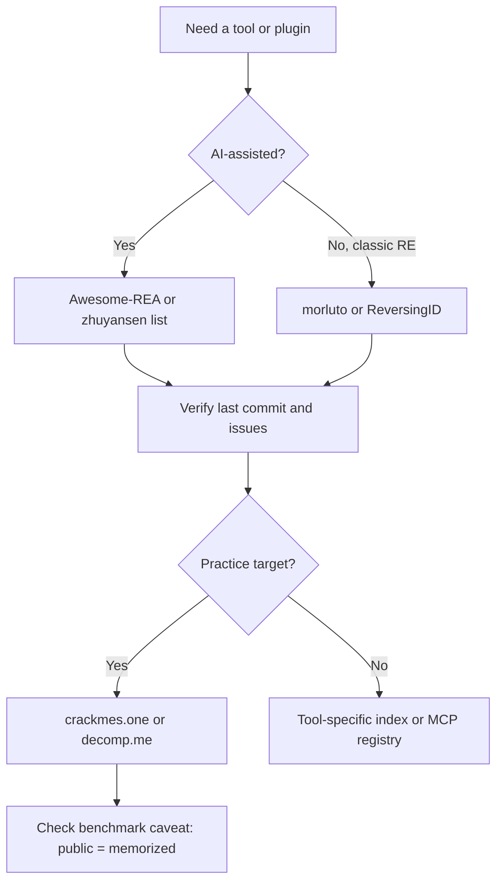
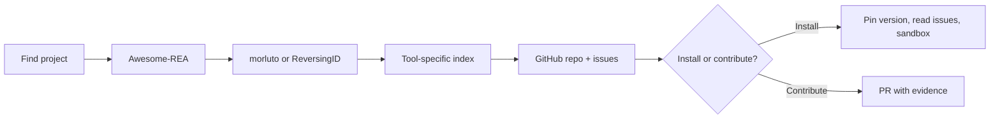

# Community Indexes and Directories

> Tags: indexes, awesome-lists, directories, communities, RSS, Discord | Difficulty: beginner | Prerequisites: none

## Overview

The RE community maintains a layer of indexes on top of the tools. These indexes are the fastest way to find a plugin, an MCP server, a practice binary, or a person who already solved your problem. This page maps the indexes that matter for AI-assisted work in 2026. It also covers practice sites, malware knowledge bases, and community channels.

Every index decays. Links rot. Projects die. Treat every list as a lead, not a verdict. Check the last commit date before you install anything. Many entries on these lists are security-sensitive. Install from source where possible. Do not paste a binary into a site you do not trust.

Facts marked "reported" or "claimed" come from community sources or vendor pages. Repo stats below were checked against the GitHub API on 2026-11-05.

## The Master Indexes

Start here. These cover the whole field.

### Awesome-REA — the best single index

- Repo: `github.com/reacher-z/Awesome-REA`
- Site: `awesomerea.org`
- Scope: tools, projects, case studies, papers, and repositories for reverse engineering with AI.
- Reported scale at research time: 885 resources, 303 case studies, 207 papers, 3,309 repositories. Machine-readable.
- State on 2026-11-05: last push 2026-11-04. About 981 GitHub stars. Active.

The site offers a browsable catalog. The repo holds the data behind it. If you build an AI-RE workflow, this is the first index to search. It is also the index that most closely tracks the agentic-RE niche.

### Classic awesome lists

These lists predate the AI wave. They index the underlying craft.

| Index | URL | What it indexes | State |
|---|---|---|---|
| ReversingID/Awesome-Reversing | github.com/ReversingID/Awesome-Reversing | Domain-split index. Software, hardware, file format, database, mobile topics | Last push 2026-05-27. About 756 stars. Curated |
| morluto/awesome-reverse-engineering | github.com/morluto/awesome-reverse-engineering | Task-organized modern list. Covers binaries, apps, firmware, and an AI-assisted section | Last push 2026-10-30. About 1,845 stars. Very active |
| wtsxDev/reverse-engineering | github.com/wtsxDev/reverse-engineering | Classic general RE list | Reported stale since 2023. Canonical for fundamentals |
| ZX41R/awesome-reverse-engineering-and-malware-analysis | github.com/ZX41R/awesome-reverse-engineering-and-malware-analysis | Verified links. Taxonomy. Researcher blogs | Small but high signal |
| edwardtay/awesome-reverse-engineering | edwardtay.github.io/awesome-reverse-engineering/ | 135 tools with safety flags | New |
| decompilation.wiki | decompilation.wiki | Decompiler internals and evaluation | Community wiki |

Use the classic lists for tool discovery. Use Awesome-REA for the AI layer. Use morluto for breadth on current tool releases.

### AI-plus-RE indexes

These lists focus on AI tools for RE. They move fast. Verify each entry before install.

| Index | URL | What it indexes | State |
|---|---|---|---|
| zhuyansen/awesome-ai-reverse-engineering | github.com/zhuyansen/awesome-ai-reverse-engineering | AI RE tools for coding agents. Reported: 117 repos security-graded, 74 MCP entries, 17 mobile, 18 skills, 4 case studies. Live mirror at agentskillshub.top | Last push 2026-11-04. About 57 stars. Active |
| DiscoverBox/awesome-ai-reverse-engineering | github.com/DiscoverBox/awesome-ai-reverse-engineering | AI RE tools by form factor. Web, binary, mobile, browser automation, traffic analysis. Bilingual (Chinese and English) | Last push 2026-11-04. About 95 stars. Active |
| ram-elgov/awesome-llm-reverse-engineering | github.com/ram-elgov/awesome-llm-reverse-engineering | LLM-for-RE papers, tools, datasets | Reported active |
| AIshihzong/awesome-reverse-engineer-anything | github.com/AIshihzong/awesome-reverse-engineer-anything | AI-RE case studies with evidence tags | Reported active |
| yibie/awesome-rea | github.com/yibie/awesome-rea | AI decompilation, recompilation, and native-port projects | Reported active |
| crowdere/Awesome-RE-MCP | github.com/crowdere/Awesome-RE-MCP | MCP servers for RE tools. Reported 28 entries at research time | Reported active |
| nforest/awesome-decompilation | github.com/nforest/awesome-decompilation | Decompilation research including AI | Reported active |
| suxnju/awesome-ai-for-software-reverse-engineering | github.com/suxnju/awesome-ai-for-software-reverse-engineering | Learning-based RE research | Reported active |

### Tool-specific and ecosystem indexes

| Index | URL | What it indexes |
|---|---|---|
| plugins.hex-rays.com | plugins.hex-rays.com | Official IDA plugin repository |
| Vector35/community-plugins | github.com/Vector35/community-plugins | Binary Ninja plugin index |
| onethawt/idaplugins-list | github.com/onethawt/idaplugins-list | IDA plugin directory. Reported stale. Last push 2024-05-31. About 3,851 stars. Still a useful name lookup |
| ghidraninja/ghidra_scripts | github.com/ghidraninja/ghidra_scripts | Ghidra scripts collection |
| grayhatacademy/ghidra_scripts | github.com/grayhatacademy/ghidra_scripts | Ghidra scripts collection |
| skills.sh | skills.sh | Agent Skills registry with install counts and security audits |
| agentskills.io | agentskills.io | Agent Skills specification |
| mcp.so | mcp.so | MCP server directory. 200 OK on 2026-11-05 |
| glama.ai/mcp | glama.ai/mcp | MCP server directory with quality grades |
| smithery.ai | smithery.ai | MCP server directory. 200 OK on 2026-11-05 |
| registry.modelcontextprotocol.io | registry.modelcontextprotocol.io | Official MCP registry. 200 OK on 2026-11-05 |
| awesome-angr | github.com/degrigis/awesome-angr | angr ecosystem list |
| awesome-embedded-security | github.com/hexsecs/awesome-embedded-security | Embedded and hardware security |

## Malware and Security Indexes

| Index | URL | What it indexes |
|---|---|---|
| Malpedia | malpedia.caad.fkie.fraunhofer.de | Malware family encyclopedia. YARA rules. MITRE ATT&CK mapping. Run by Fraunhofer FKIE. 200 OK on 2026-11-05 |
| rshipp/awesome-malware-analysis | github.com/rshipp/awesome-malware-analysis | Huge malware-analysis taxonomy. Reported stale since 2024 |
| pedramamini/awesome-yara | github.com/pedramamini/awesome-yara | YARA rules, tools, people |
| vx-underground/MalwareSourceCode | github.com/vxunderground/MalwareSourceCode | Malware source-code corpus by platform |
| sbilly/awesome-security | github.com/sbilly/awesome-security | General security list |

Malpedia deserves special mention. It is the reference when you meet a named family. It gives you YARA rules, ATT&CK techniques, and related families. It also gives you a place to check whether an agent's family attribution matches public knowledge.

## Practice and Challenge Indexes

| Index | URL | What it indexes |
|---|---|---|
| crackmes.one | crackmes.one | Crackme practice index. Difficulty-rated. 200 OK on 2026-11-05 |
| decomp.me | decomp.me | Collaborative matching-decompilation platform. REST API. Self-hostable. Source at github.com/decompme/decomp.me. About 654 stars. Last push 2026-11-04 |
| CTFtime | ctftime.org/ctfs | CTF event archive. Reported 403 to automated fetch on 2026-11-05. Site works in browsers |
| sajjadium/ctf-archives | github.com/sajjadium/ctf-archives | GitHub CTF challenge collection |
| pwncollege/ctf-archive | github.com/pwncollege/ctf-archive | CTF archive |
| flare-on.com | flare-on.com | FireEye FLARE CTF archives. 200 OK on 2026-11-05 |
| challenges.re | challenges.re | RE challenges. 200 OK on 2026-11-05 |
| beginners.re | beginners.re | RE4B, the canonical free RE textbook. 200 OK on 2026-11-05 |

Practice sites matter for AI work for one reason: benchmarks. Public crackmes and CTF challenges are memorized by frontier models. A model that aces crackmes.one may still fail on a fresh binary. Generated corpora discriminate better. Reported benchmark result: CrackMeBench generated set reached 92 percent pass@3 for the top model, while public calibration was far lower. Treat public practice scores as a floor, not a ceiling.

## Game and Firmware Indexes

| Index | URL | What it indexes |
|---|---|---|
| SubmitGame/awesome-decomp-games | github.com/SubmitGame/awesome-decomp-games | Rated, auto-refreshed list of decompiled, recompiled, and reverse-engineered games. About 2,873 stars. Last push 2026-11-03 |
| heaven-hm/awesome-reverse-engineered-games | github.com/heaven-hm/awesome-reverse-engineered-games | AI-rebuilt games case studies |
| recomp.fyi | recomp.fyi | Recomp project registry. 200 OK on 2026-11-05 |
| retroportingtoolkit.com | retroportingtoolkit.com | Console recomp collective and Discord hub. 200 OK on 2026-11-05 |

SubmitGame is the best current map of the decomp and recomp scene. Use it to find an existing project before you start a fresh port. Check the project's repository state. Many listed projects are stalled.

## Community Channels

Indexes tell you what exists. Communities tell you what works this month.

| Community | URL | Notes |
|---|---|---|
| r/ReverseEngineering | reddit.com/r/ReverseEngineering | Reported about 144k members. Tool releases surface here first |
| r/Malware | reddit.com/r/Malware | Reported about 71k members. OALABS workshops and malware discussion |
| OALABS Discord | discord.gg/oalabs | Live RE discussions. Unverified link, confirm in browser |
| Ghidra Discord | discord.gg/NXaxkXbfW8 | Ghidra community. MCP ecosystem discussed. Unverified link |
| R.A.I.D. Discord | RetroPortingToolKit | Console recomp community, linked from retroportingtoolkit.com |
| Hacker News | news.ycombinator.com | AI-RE tools surface regularly. Search "reverse engineering" and "decompiler" |

Discord links rot. Treat all Discord invite URLs as unverified until you open them.

## How to Contribute

Each index has its own contribution path. Match the effort to the value.

### Awesome-REA

Contribution goes through the repo at `github.com/reacher-z/Awesome-REA`. Read the contribution guide in the repo before you open a PR. Entries need evidence. A case study with a writeup beats a bare link. If you have an AI-RE project with reproducible results, this is the highest-value submission target.

### Classic awesome lists

ReversingID, morluto, wtsxDev, and ZX41R all take GitHub pull requests. Check each repo's `CONTRIBUTING` file or README rules first. Most require alphabetical placement, a short description, and a working link. Do not submit your own project more than once. Do not submit wrappers around paid services without disclosure.

### zhuyansen and DiscoverBox AI lists

Both are GitHub repos with PR-based contribution. zhuyansen grades entries by security posture. DiscoverBox organizes by form factor and is bilingual. Submit with a clear category and a one-line capability description.

### MCP registries

MCP servers reach users through several registries. The official registry is `registry.modelcontextprotocol.io`. Community directories include mcp.so, glama.ai/mcp, and smithery.ai. For agent skills, skills.sh and agentskills.io are the reference points. Publishing to a registry usually means publishing the package first on npm, PyPI, or GitHub, then submitting metadata.

### crackmes.one and decomp.me

crackmes.one accepts user submissions through its site. Upload an original crackme with a difficulty rating and a short description. Do not upload cracked solutions as the challenge itself.

decomp.me accepts new matching projects through its site. The project needs a buildable target, a Makefile or CMake setup, and a baseline. Read the contribution docs at github.com/decompme/decomp.me before you start. A decomp project is a long-running commitment, not a drive-by submission.

### Malpedia

Malpedia is maintained by Fraunhofer FKIE. Contributions and corrections go through the site's contact channel. Do not expect open PRs. If you find a wrong YARA rule or a missing family, report it with evidence.

### SubmitGame

The list is described as auto-refreshed. The source data comes from the community's project tracking. If you run a decomp or recomp project, check the repo README for the current submission mechanism before you assume a manual PR is needed.

## RSS and Feed Options

Most indexes do not publish RSS. The reliable feeds are the ones below.

| Source | Feed | Notes |
|---|---|---|
| Reddit | `reddit.com/r/ReverseEngineering/.rss` and `reddit.com/r/Malware/.rss` | Works without login. Filter for "release", "MCP", "Ghidra" |
| Hacker News | `hnrss.org/frontpage` or the Algolia API | Search API at `hn.algolia.com` is the better tool for keyword queries |
| GitHub | Per-repo release feeds and the GitHub events API | Watch the repos in this page. `gh api repos/<owner>/<repo>/events` works for automation |
| awesome lists | None | These are edited files, not feeds. Re-check the repos you depend on monthly |

For automation, poll GitHub instead of scraping pages. The API gives you `pushed_at`, release tags, and star counts in one call. Rate limits apply. Authenticate with `gh auth login` or a token.

## How to Pick an Index

## Pitfalls

- **Star counts lie.** A repo with 3,000 stars can be abandoned. Check `pushed_at`, not stars.
- **AI-RE lists churn fastest.** A tool listed this month may be renamed, archived, or bought next month. Re-verify quarterly.
- **Memorization contamination.** Public crackmes and CTF writeups are in training data. A model solving them proves recall, not skill. Use generated corpora for real signal.
- **Duplicate and wrapper projects.** Many AI-RE repos are thin wrappers around one MCP server. Check the dependency tree before you adopt one.
- **Security-graded lists are opinions.** zhuyansen's grading is useful. It is still a judgment call. Read the linked issues before you trust a grade.
- **Bilingual lists lose entries in translation.** DiscoverBox covers Chinese-language tooling that English lists miss. Do not skip it if your stack includes Chinese vendors.
- **Plugin directories go stale.** onethawt/idaplugins-list has not been pushed since 2024-05. Use plugins.hex-rays.com for current IDA plugins.
- **Discord invites expire.** All Discord links in this page are reported, not verified. Confirm before you share them.
- **Auto-refreshed lists still lie.** SubmitGame refreshes data, but project health varies. Check each repo's commit history.

## See Also

- ../05-tools/tool-catalog.md — tool-by-tool catalog with MCP status and licenses
- ../05-tools/mcp-catalog.md — every MCP server for RE tools
- ../05-tools/skills-catalog.md — Agent Skills format and RE skill repos
- ../04-recomp/matching-decomp.md — decomp.me workflow detail
- ../06-topics/malware-analysis.md — malware triage and Malpedia usage
- ../07-advanced/model-selection.md — benchmarks and model choice
- ../09-ops/notes-and-evidence.md — where to record what you learn from indexes
- ../99-meta/cheatsheet.md — one-screen command and prompt reference
- ../99-meta/glossary.md — RE and agent terms

## Sources

- https://github.com/reacher-z/Awesome-REA — Awesome-REA repo
- https://awesomerea.org — Awesome-REA site
- https://github.com/ReversingID/Awesome-Reversing — Awesome-Reversing
- https://github.com/morluto/awesome-reverse-engineering — morluto list
- https://github.com/wtsxDev/reverse-engineering — wtsxDev list
- https://github.com/ZX41R/awesome-reverse-engineering-and-malware-analysis — ZX41R list
- https://edwardtay.github.io/awesome-reverse-engineering/ — edwardtay list
- https://decompilation.wiki — decompiler wiki
- https://github.com/zhuyansen/awesome-ai-reverse-engineering — zhuyansen AI RE list
- https://github.com/DiscoverBox/awesome-ai-reverse-engineering — DiscoverBox list
- https://github.com/ram-elgov/awesome-llm-reverse-engineering — LLM RE papers list
- https://github.com/AIshihzong/awesome-reverse-engineer-anything — case-study list
- https://github.com/yibie/awesome-rea — yibie AI REA list
- https://github.com/crowdere/Awesome-RE-MCP — MCP server list
- https://github.com/nforest/awesome-decompilation — decompilation research list
- https://github.com/suxnju/awesome-ai-for-software-reverse-engineering — learning-based RE list
- https://malpedia.caad.fkie.fraunhofer.de — Malpedia
- https://github.com/rshipp/awesome-malware-analysis — malware analysis list
- https://github.com/pedramamini/awesome-yara — YARA list
- https://github.com/vxunderground/MalwareSourceCode — malware source corpus
- https://github.com/sbilly/awesome-security — security list
- https://crackmes.one — crackme index
- https://www.decomp.me — decomp.me platform
- https://github.com/decompme/decomp.me — decomp.me source
- https://ctftime.org/ctfs — CTFtime
- https://github.com/sajjadium/ctf-archives — CTF archives
- https://github.com/pwncollege/ctf-archive — pwn.college archive
- https://flare-on.com — FLARE-On archives
- https://challenges.re — RE challenges
- https://beginners.re — RE4B
- https://github.com/onethawt/idaplugins-list — IDA plugin list
- https://plugins.hex-rays.com — IDA plugin repository
- https://github.com/Vector35/community-plugins — Binary Ninja plugins
- https://github.com/ghidraninja/ghidra_scripts — Ghidra scripts
- https://github.com/grayhatacademy/ghidra_scripts — Ghidra scripts
- https://skills.sh — skills registry
- https://agentskills.io — skills spec
- https://mcp.so — MCP directory
- https://glama.ai/mcp — MCP directory
- https://smithery.ai — MCP directory
- https://registry.modelcontextprotocol.io — official MCP registry
- https://github.com/degrigis/awesome-angr — angr ecosystem
- https://github.com/hexsecs/awesome-embedded-security — embedded security
- https://github.com/SubmitGame/awesome-decomp-games — decomp games list
- https://github.com/heaven-hm/awesome-reverse-engineered-games — AI-rebuilt games
- https://recomp.fyi — recomp registry
- https://retroportingtoolkit.com — console recomp community
- https://www.reddit.com/r/ReverseEngineering — r/ReverseEngineering
- https://www.reddit.com/r/Malware — r/Malware
- https://discord.gg/oalabs — OALABS Discord (unverified)
- https://discord.gg/NXaxkXbfW8 — Ghidra Discord (unverified)
- https://news.ycombinator.com — Hacker News
