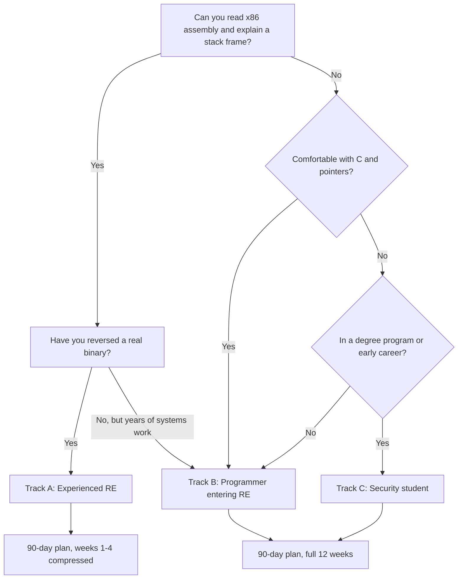

# Learning Paths: From Zero to AI-Assisted RE

> Tags: learning, career, practice, curriculum | Difficulty: Beginner to Intermediate | Prerequisites: None for Track A/B entry. Track C needs basic systems knowledge.

## Overview

Most RE practice material is written for the world before 2023. It teaches decompiler output, debugger mechanics, and crackme solving. It does not teach agent workflows. This page builds three concrete paths that do both.

The three tracks:

| Track | Who you are | What changes with AI |
|---|---|---|
| A | Experienced RE adding AI | New habits: verification loops, chunking, model routing. Skills transfer. |
| B | Programmer entering RE | Faster ramp-up. AI covers terminology gaps. Fundamentals still required. |
| C | Security student | Longest path. Mostly Track B plus exploit fundamentals and safe-lab discipline. |



All three tracks converge on the same rule. You must be able to verify the AI's answer without the AI. If you cannot read assembly and check the pseudocode against the disassembly, the AI is a confidence machine, not a tool.

Free practice sources used on all tracks:

- pwn.college — gamified CTF curriculum, free, has a reverse-engineering dojo.
- RE4B "Reverse Engineering for Beginners" — free textbook at beginners.re. Chapters on assembly, calling conventions, and memory are the bedrock.
- OALABS — free YouTube RE101-series videos and Discord.
- RPISEC MBE — free classical exploitation curriculum at github.com/RPISEC/MBE. Dated, but the fundamentals hold.
- Malware Unicorn RE101 — free Windows malware-analysis workshop with a downloadable VM lab.
- TryHackMe Windows Reversing rooms — guided, paid partially.

Paid training sources:

- REcon — recon.cx. Flagship RE conference with dedicated AI trainings. The 2026 lineup includes "Automating RE with AI/ML, Graphs, and LLM Agents", "Building Agentic RE", "AI Agents for Cybersecurity", and "Software Deobfuscation Techniques".
- Black Hat USA trainings — cert.blackhat.com. "Automating RE with AI/ML" taught by the same team as the REcon course.
- FuzzingLabs — fuzzinglabs.com. "Applied AI/LLM for Android APK Reversing" covers jadx MCP, Ghidra MCP, AI decompilation, and Frida script generation.
- Udemy "AI and MCP for Reverse Engineering" — self-paced. Verify instructor credibility before paying.

## Setup

Before any track starts, build the lab once.

1. Follow [linux-sandbox-base](../01-setup/linux-sandbox-base.md) on Ubuntu. Install Ghidra 12.2, radare2 6.2.4 or rizin 0.9.1, Python 3.12, and an MCP-capable agent harness.
2. Install FLARE-VM for Windows work, or a Windows analysis VM. See [malware-isolation](../01-setup/malware-isolation.md).
3. Wire one MCP server to one decompiler. See [mcp-catalog](../05-tools/mcp-catalog.md). A safe first choice is the official Hex-Rays `ida-mcp` for IDA 9.5 or GhidraMCP for Ghidra 12.2.
4. Set the agent's permission model to read-and-run, not read-and-write. See [agent-sandboxing](../01-setup/agent-sandboxing.md).
5. Create an empty analysis directory with this layout:

```text
analysis/
  lab/
    crackmes/      # downloaded challenges
    own/           # binaries you compiled
    ctf/           # challenge archives
  notes/           # evidence ledgers, see notes-and-evidence
  exports/         # decompiler dumps, Ghidra project files
```

## Track A: Experienced RE Adding AI

You already know PE headers, calling conventions, and x64dbg. Weeks 1–3 teach the AI layer.

| Week | Milestone | What you do | How you know you are done |
|---|---|---|---|
| 1 | Harness wired | Install MCP on your existing tool. Run [claude-code-setup](../02-collab/claude-code-setup.md) or the Codex equivalent. Feed one known binary. | Agent lists functions, you verify three names against disassembly. |
| 2 | Chunking habit | Run [triage-and-mapping](../03-decomp/triage-and-mapping.md) on a real target. Produce the map document. | Agent cannot see more than 50 functions per prompt. |
| 3 | Verification loop | Run [verification-loop](../03-decomp/verification-loop.md) end to end on one function family. | You reject at least one hallucinated rename and log it. |
| 4 | Batch decompile | Run [batch-decompilation](../03-decomp/batch-decompilation.md) on a medium binary. Spot-check 5 percent. | Token spend is within budget. See [cost-tracking](../09-ops/cost-tracking.md). |
| 5 | Dynamic + AI | One Frida script generated by AI, reviewed line by line. See [frida-deep-dive](../04-dynamic/frida-deep-dive.md). | Script runs once without modification. |
| 6 | Full recipe | Complete one [real-world-recipes](../08-case-studies/real-world-recipes.md) walkthrough. | Evidence ledger is complete. |

Common Track A mistake: trusting the agent's function names. Resist this. Rename only after you read the disassembly. See [reading-pseudocode](../00-fundamentals/reading-pseudocode.md).

## Track B: Programmer Entering RE

You can read C and Python. You have never reversed a binary. Weeks 1–8 cover fundamentals with AI as a tutor, not a crutch.

| Week | Milestone | What you do | How you know you are done |
|---|---|---|---|
| 1–2 | Assembly basics | Read [assembly-crash-course](../00-fundamentals/assembly-crash-course.md). Do the drills. Do pwn.college's first reverse-engineering dojo modules. | You can explain what `push`, `mov`, `call`, `ret` do on the stack. |
| 3–4 | Binary formats | Read [binary-formats](../00-fundamentals/binary-formats.md). Load `notepad.exe` and `/bin/ls` in Ghidra. | You can find imports, entry point, and sections unaided. |
| 5–6 | First crackme | Solve 3 crackmes from crackmes.one at difficulty 1–2. Use AI only for hints after 30 minutes of manual work. | You patch or keygen one without AI. |
| 7 | Decompiler fluency | Run [decompile-workflow](../03-decomp/decompile-workflow.md) on a crackme. Compare pseudocode to disassembly line by line. | You can spot one decompiler artifact. |
| 8 | First AI-assisted triage | Run the [30-minute triage prompt chain](../02-collab/llm-workflows-recipes.md) on a crackme. | You verify every claim the agent makes. |

Track B rule: the AI may explain terms and suggest commands. It may not solve the crackme for you during weeks 1–8. If it does, you will fail the milestone test because you cannot reproduce the solution manually.

## Track C: Security Student

You are in a degree program or early career. You need fundamentals plus exploit knowledge plus lab discipline. Weeks 1–12 are the honest minimum.

| Week | Milestone | What you do | How you know you are done |
|---|---|---|---|
| 1–4 | Track B weeks 1–4 | Same as Track B. Assembly, formats, debugger basics. | Pass the same checks. |
| 5–8 | Exploit foundations | RPISEC MBE modules 1–4. pwn.college program-security and binary-exploitation dojos. | You can write a stack-smash exploit against a provided binary. |
| 9–10 | Malware triage lab | Malware Unicorn RE101. Build the VM lab it provides. Do not use your host. | You complete the workshop's Unknown.exe analysis. |
| 11–12 | AI layer | Track A weeks 1–3 compressed. MCP setup, chunking, verification. | You reject a hallucinated AI claim and document it. |

Track C extra requirement: read [legal-and-ethics](../09-ops/legal-and-ethics.md) before touching anything that is not yours or a published challenge. The DMCA §1201 and CFAE bright lines apply to students too.

## Step-by-Step: The 90-Day Plan

This plan assumes Track B entry. Experienced RE users (Track A) can compress weeks 1–4 into week 1.

### Days 1–30: Fundamentals Without AI

- Days 1–7: Read RE4B chapters on assembly and the x86 calling convention. Do pwn.college reverse-engineering dojo belt 1.
- Days 8–14: Read RE4B on the PE format and Windows internals. Load three real binaries in Ghidra. Do not use AI yet.
- Days 15–21: Solve 5 crackmes at difficulty 1–3. Time-box each at 2 hours. Write a one-paragraph solution for each.
- Days 22–30: Do Malware Unicorn RE101 triage section. Build the lab VM. Take a snapshot.

Milestone: you can explain why a function pushes arguments in reverse order, and you have solved 5 crackmes with written notes.

### Days 31–60: The AI Layer

- Days 31–37: Set up the sandbox from [linux-sandbox-base](../01-setup/linux-sandbox-base.md). Install the agent harness and one MCP server. See [claude-code-setup](../02-collab/claude-code-setup.md).
- Days 38–44: Read [prompt-patterns](../02-collab/prompt-patterns.md). Run the triage prompt chain on a crackme you already solved. Compare the AI's map to your notes.
- Days 45–51: Read [verification-loop](../03-decomp/verification-loop.md). Pick 10 functions. Have the agent rename them. Verify each rename yourself. Log the false positives.
- Days 52–60: Do one TryHackMe Windows Reversing room with AI assistance. Then redo it without AI. Compare time and confidence.

Milestone: you can state the false-positive rate of the agent on your own test set. If you cannot, you have not verified enough.

### Days 61–90: Specialization and Real Targets

- Days 61–70: Pick one specialization: PE malware, Android APK, firmware, or .NET. Follow the matching [06-topics](../06-topics/index.md) page. Do FuzzingLabs' free APK material if you pick Android.
- Days 71–80: Complete one CTF reverse-engineering challenge from a recent CTFtime event. Use the full AI workflow: map, batch decompile, verify, document. See [daily-workflows](../09-ops/daily-workflows.md).
- Days 81–90: Do a capstone. Pick a packed binary from [packed-binaries](../06-topics/packed-binaries.md) or a protocol from [protocol-reverse](../06-topics/protocol-reverse.md). Run the full pipeline. Write a public writeup only if the rules allow it.

Milestone: you have one complete, verified, documented analysis you could show in an interview.

### 90-Day Checklist

- [ ] 5 crackmes solved and documented
- [ ] 1 CTF challenge completed end-to-end
- [ ] 1 MCP server installed and used daily
- [ ] 1 verification loop run with logged false positives
- [ ] 1 specialization page read cover to cover
- [ ] 1 notes vault with evidence ledgers, per [notes-and-evidence](../09-ops/notes-and-evidence.md)

## Communities and Indexes

Learning accelerates when you have people to ask. These communities are active as of 2026.

| Community | Where | Best for |
|---|---|---|
| r/ReverseEngineering | reddit.com/r/ReverseEngineering | Tool releases, general questions. About 144k members reported. |
| r/Malware | reddit.com/r/Malware | Malware analysis discussion. About 71k members reported. |
| OALABS Discord | discord.gg/oalabs | Live RE help. Companion to the YouTube channel. |
| Ghidra Discord | discord.gg/NXaxkXbfW8 | Ghidra-specific questions and MCP ecosystem talk. |
| R.A.I.D. Discord | RetroPortingToolKit | Console game recompilation. |
| Awesome-REA | awesomerea.org | Machine-readable index of 885 resources, 303 case studies, 207 papers, 3,309 repos. Best single index. |
| Awesome AI-RE lists | github.com/zhuyansen/awesome-ai-reverse-engineering | AI-specific RE tools, MCP servers, skills. Security-graded. |

Use the indexes to find new tools. Use the communities to ask questions. Use the wiki pages for verified setup instructions.

### Resource Verification Notes

The report marks some resources as dated or partially verified:

- RPISEC MBE is a classic curriculum. Some material is dated. The fundamentals still hold.
- TryHackMe Windows Reversing has both free and paid rooms. Check the current pricing.
- The Udemy "AI and MCP for Reverse Engineering" course is self-paced. Instructor credibility varies. Read reviews before buying.
- challenges.re hosts RE4B exercises. It did not respond to automated checks during wiki writing. Verify it loads before relying on it.
- crackmes.one is the canonical crackme index. It did not respond to automated checks during wiki writing. Verify it loads. If it is down, use pwn.college and CTF archives instead.

## Choosing Models Along the Path

Model choice changes as you progress. See [model-selection](../07-advanced/model-selection.md) for the full picture.

| Phase | Recommended approach | Why |
|---|---|---|
| Fundamentals, days 1–30 | No frontier model on crackmes. Local model or none. | Memorization risk. You need struggle to learn. |
| AI layer, days 31–60 | One frontier model for explanation. A cheaper model for bulk renaming. | Explanation quality matters. Bulk work is cheap. |
| Specialization, days 61–90 | Route by task: frontier for novel binaries, cheap for known patterns. | Cost control. See [cost-tracking](../09-ops/cost-tracking.md). |

Do not use Claude Opus 5.5 for RE work. Reported classifier issues halt RE requests mid-answer. Anthropic routes cyber tasks to Opus 4.8. See the model-selection page for details.

### Weekly Practice Rhythm

A sustainable weekly rhythm for all tracks:

| Day | Activity | Time |
|---|---|---|
| Mon | Read one RE4B chapter or one OALABS video. Take notes by hand. | 60 min |
| Tue | Solve one crackme or CTF challenge. AI allowed only after 30 min manual. | 90 min |
| Wed | AI-assisted analysis of a binary you already solved. Compare outputs. | 60 min |
| Thu | Verification drill. Pick 10 functions. Verify agent renames. | 60 min |
| Fri | Write up the week. Update the evidence ledger. | 30 min |
| Sat | Optional: pwn.college dojo module or TryHackMe room. | 90 min |
| Sun | Rest or light reading. Review notes. | 30 min |

Total: about 6 hours per week. This fits around a job. The 90-day plan assumes this rhythm.

### What AI Is Good For at Each Stage

| Stage | Good AI use | Bad AI use |
|---|---|---|
| Fundamentals | Explaining assembly idioms, defining terms, suggesting reading order | Solving the crackme for you |
| AI layer | Generating MCP configs, drafting prompts, summarizing call graphs | Renaming functions without your verification |
| Specialization | Frida script drafts, protocol grammar hints, deobfuscation pattern matching | Trusting its deobfuscation output without a re-check |
| Daily work | Bulk triage, batch decompilation, evidence ledger drafting | Autonomous analysis of hostile binaries without isolation |

The pattern: AI drafts. You verify. Deterministic tools decide. See [verification-loop](../03-decomp/verification-loop.md).

## Safe Practice Rules

Practice safely or do not practice at all. These rules apply to every track.

1. **Crackmes first.** crackmes.one is the canonical index. Start at difficulty 1. Move up only when you can solve the current tier without AI.
2. **CTFs second.** CTFtime archives and pwn.college's dojo are fair game. Read the rules. Some CTFs prohibit AI assistance. Respect that.
3. **Own binaries always.** Compile a C program, strip it, and reverse it. You know the answer, so verification is trivial. This is the best AI-verification training data you can get.
4. **Never live malware on a host.** Use the VM lab from Malware Unicorn RE101 or the sandbox in [malware-isolation](../01-setup/malware-isolation.md). Snapshot before every run.
5. **No real targets without authorization.** Commercial software, DRM, anti-cheat, and licensed firmware are off-limits unless you have written permission. See [legal-and-ethics](../09-ops/legal-and-ethics.md).
6. **Sandbox the agent, not just the binary.** The binary may contain prompt injection. See [ai-security-threats](../07-advanced/ai-security-threats.md) before pointing an agent at hostile input.

## Pitfalls

- **Skipping fundamentals because the AI "handles it".** The AI handles syntax, not judgment. If you cannot read the disassembly, you cannot verify the pseudocode.
- **Using AI on crackmes during the fundamentals phase.** You will memorize the answer, not the skill. Time-box manual work first.
- **Trusting decompiler names.** Ghidra's `FUN_00401000` and IDA's `sub_401000` are placeholders. The AI will invent better names. Verify against the disassembly.
- **Running malware on a host VM with network access.** One mistake and the lab is gone. Snapshot, isolate, and sinkhole DNS. See [network-isolation](../01-setup/network-isolation.md).
- **Buying a course before finishing the free material.** REcon and Black Hat AI-RE courses assume you already reverse binaries. If you cannot solve a difficulty-3 crackme, the course will be noise.
- **Treating CTF rules as optional.** Many CTFs now have explicit AI policies. Read them. Some ban LLM assistance outright.

## See Also

- [Assembly Crash Course](../00-fundamentals/assembly-crash-course.md)
- [Binary Formats](../00-fundamentals/binary-formats.md)
- [Reading Pseudocode](../00-fundamentals/reading-pseudocode.md)
- [Linux Sandbox Base](../01-setup/linux-sandbox-base.md)
- [Malware Isolation](../01-setup/malware-isolation.md)
- [Agent Sandboxing](../01-setup/agent-sandboxing.md)
- [Prompt Patterns](../02-collab/prompt-patterns.md)
- [Verification Loop](../03-decomp/verification-loop.md)
- [Daily Workflows](../09-ops/daily-workflows.md)
- [Legal and Ethics](../09-ops/legal-and-ethics.md)
- [AI Security Threats](../07-advanced/ai-security-threats.md)
